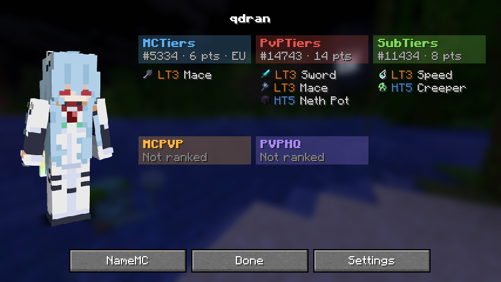
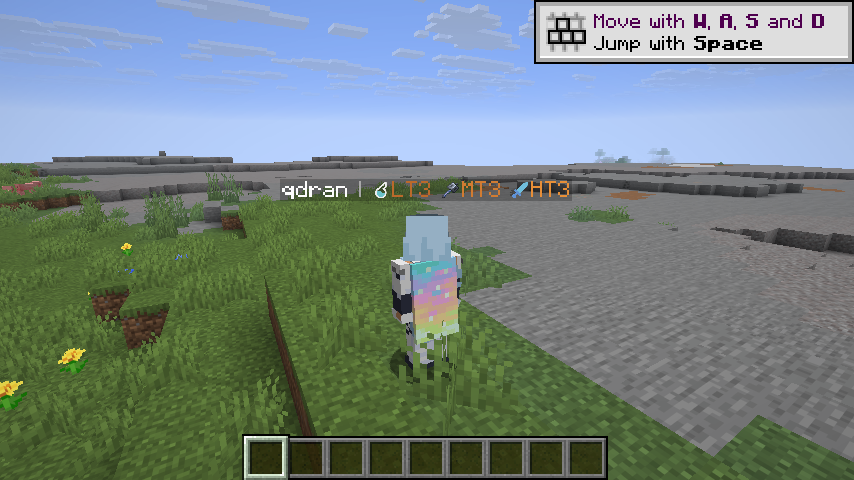
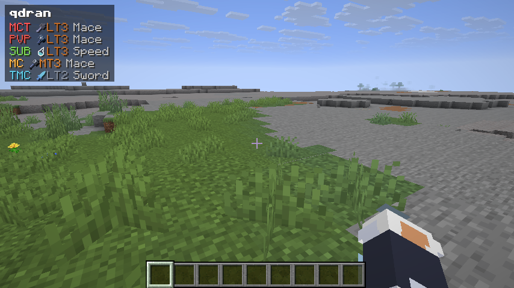
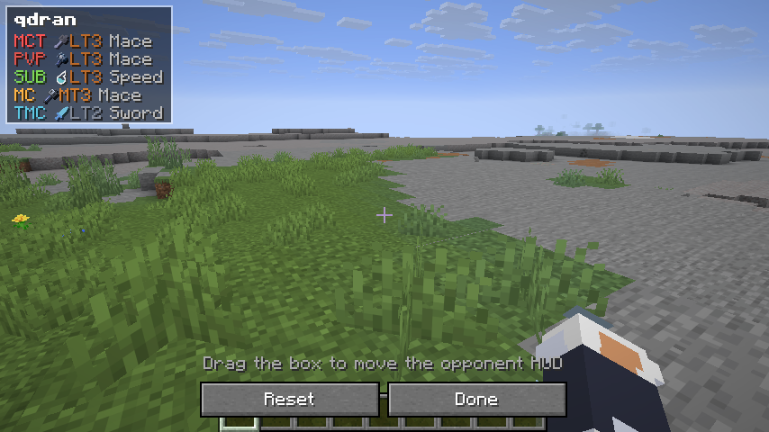
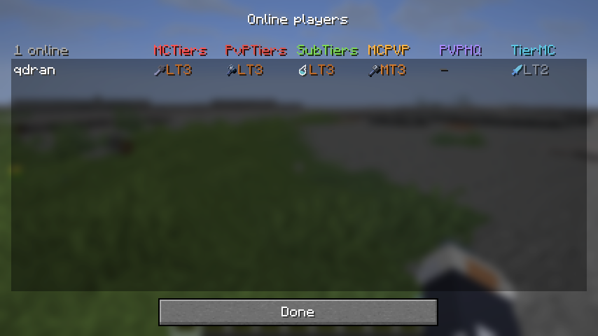
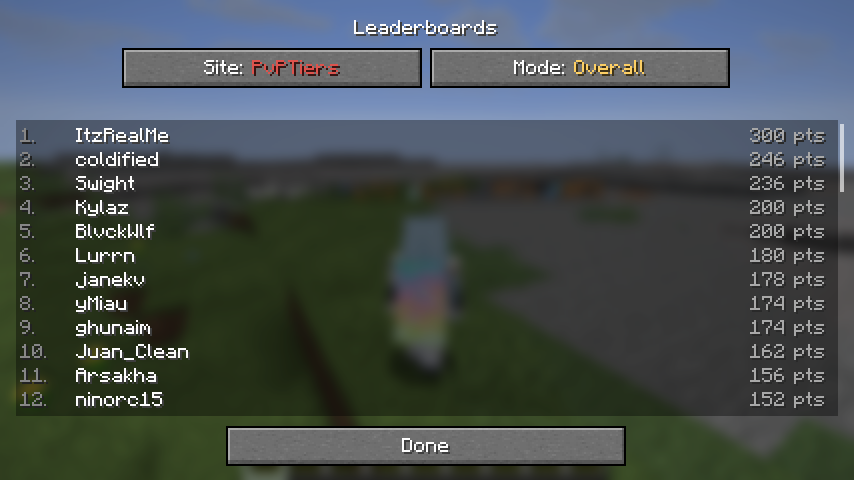
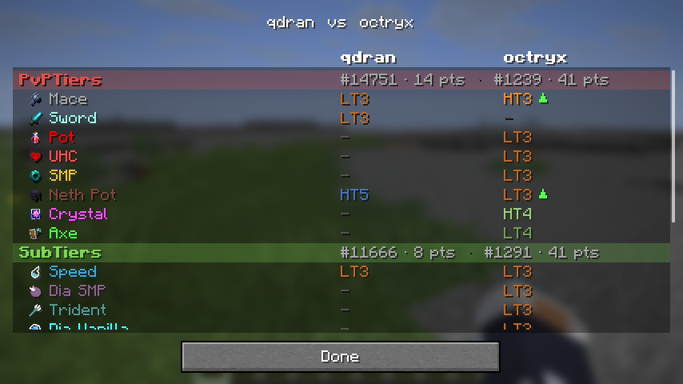
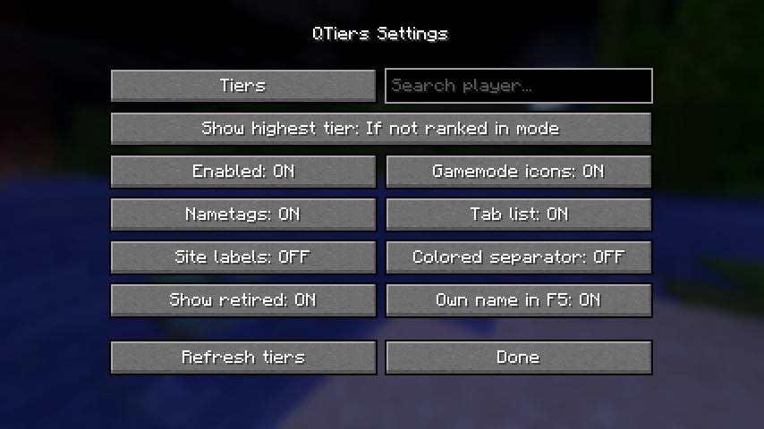
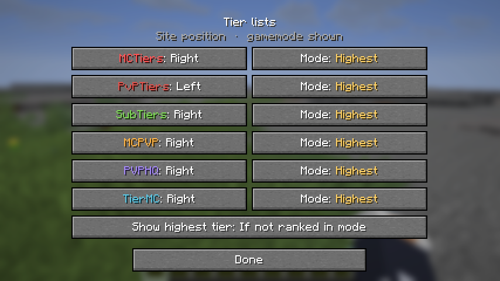

# QTiers

**Every PvP tier list, right next to a player's name.**

QTiers is a Fabric client mod that shows players' tier-list ranks in nametags and in the tab list. It covers six tier lists at once:

| Tier list | Label |
|---|---|
| [MCTiers](https://mctiers.net) | MCT |
| [PvPTiers](https://pvptiers.com) | PVP |
| [SubTiers](https://subtiers.net) | SUB |
| [MCPVP](https://www.mcpvp.com) | MC |
| [PVPHQ](https://pvphq.com) | HQ |
| [TierMC](https://tiermc.com) | TMC |

It works like TierTagger, but covers every site, and each site keeps its own icons. It runs only on your client, so it works on any server, including ones with custom nametags like mcpvp.club.

**Minecraft versions:** 1.21.4, 1.21.6 – 1.21.8, 1.21.11, 26.1 – 26.1.2, 26.2 and 26.3.



## Features

### Tiers next to names
- Put each tier list on the **left** or **right** of the name, or turn it **off**.
- Show one **gamemode** per tier list, or the player's **highest** tier. If a player isn't ranked in your gamemode, QTiers can fall back to their highest tier (*Never*, *If not ranked in mode*, *Always*, as in TierTagger).
- Every tier list uses **its own gamemode icons** from its own website.
- Tier colors come from **MCPVP**, from HT1 gold down to LT6 brown. Retired tiers show as `RHT1` in light blue.
- Tiers are **saved between sessions**, so they show the moment you join and refresh in the background.

### Your own name in F5
In third person you see your own nametag with your tiers, like the WhoAmI mod.



### Opponent HUD
When you hit a player, a small box shows their tiers on every site for 10 seconds.



Press **Move** next to "Opponent HUD" in the settings to drag the box anywhere on the screen. It stays in the same spot on any resolution or GUI scale.



### Player profiles
`/qtiers <player>` opens a profile with a full-body skin render and every tier, peak, point total, rank and region from all six sites, plus a button to open the player's NameMC page. To open a profile you can also:
- press **H** for the player nearest to you,
- click a player's name in chat,
- type a name into the search box on the profile or settings screen and press Enter.

### Online players
`/qtiers list` shows everyone on the server, strongest first, with each site's tier in its own column. Click a name to open their profile.



### Leaderboards
`/qtiers top` shows the top players of **MCTiers**, **PvPTiers**, **SubTiers** or **TierMC**, overall or for one gamemode. Click a name to open their profile. PVPHQ and MCPVP have no public leaderboard, so they aren't included.



### Compare players
`/qtiers compare <player1> <player2>` puts two players side by side, site by site. When both are ranked in a gamemode, the better tier gets a ▲.



### Settings
Open the settings with `/qtiers`, a keybind, or the Configure button in [Mod Menu](https://modrinth.com/mod/modmenu). The **Tiers** button opens a page where you choose each site's position and gamemode, and when to show the highest tier.

<p>
  
  
</p>

| Setting | What it does |
|---|---|
| Enabled | Turns QTiers on or off |
| Gamemode icons | Shows the gamemode icon in front of each tier |
| Nametags / Tab list | Where tiers are shown |
| Site labels | Adds MCT / PVP / SUB / MC / HQ / TMC in front of each tier |
| Colored separator | The `\|` next to the name takes the tier's color |
| Show retired | Includes retired tiers |
| Own name in F5 | Shows your own nametag in third person |
| Opponent HUD | Shows the tiers of the last player you hit; **Move** places it |
| Clickable chat names | Clicking a name in chat opens that player's profile |

## Commands
| Command | What it does |
|---|---|
| `/qtiers <player>` | Opens that player's profile. Online names tab-complete. |
| `/qtiers list` | Shows everyone online with their tiers |
| `/qtiers top` | Opens the leaderboards |
| `/qtiers compare <a> <b>` | Compares two players |
| `/qtiers` or `/qtiers settings` | Opens the settings |
| `/qtiers reload` | Reloads the config and fetches tiers again |
| `/qtiers debug` | Writes what the server sends for names and the tab list to the log, for servers where tiers don't show |

## Keybinds
Set them under Options → Controls → QTiers.

| Action | Default |
|---|---|
| Open nearest player's profile | H |
| Open online players | unbound |
| Open leaderboards | unbound |
| Cycle the MCTiers / PvPTiers / SubTiers / MCPVP / PVPHQ / TierMC gamemode | unbound |
| Toggle QTiers | unbound |
| Open settings | unbound |

## Install
1. Install [Fabric Loader](https://fabricmc.net/use/) for your Minecraft version.
2. Download the jar for your version from the [latest release](https://github.com/Adrian1337afk/qtiers/releases/latest):

   | Minecraft | Jar |
   |---|---|
   | 1.21.4 | `qtiers-1.6.0+1.21.4.jar` |
   | 1.21.6 – 1.21.8 | `qtiers-1.6.0+1.21.8.jar` |
   | 1.21.11 | `qtiers-1.6.0+1.21.11.jar` |
   | 26.1 – 26.1.2 | `qtiers-1.6.0+26.1.jar` |
   | 26.2 | `qtiers-1.6.0+26.2.jar` |
   | 26.3 | `qtiers-1.6.0+26.3.jar` |

3. Put it and [Fabric API](https://modrinth.com/mod/fabric-api) in `.minecraft/mods`.
4. Optional: add [Mod Menu](https://modrinth.com/mod/modmenu) to open the settings from the mod list.

## Build
```
gradlew collectJars
```
One jar per Minecraft version ends up in `build/libs/`. Shared code (APIs, parsers, config, cache) lives in `common/`; each version's Minecraft-facing code is in `versions/<minecraft>/`.

## Credits
- **Tier data:** the [MCTiers](https://mctiers.net/docs/v2), [PvPTiers](https://pvptiers.com), [SubTiers](https://subtiers.net), [PVPHQ](https://pvphq.com) and [TierMC](https://tiermc.com/api.html) APIs, and public [MCPVP](https://www.mcpvp.com) profile pages (MCPVP has no API).
- **Gamemode icons:** each tier list's own website. They belong to those sites.
- **Tier colors:** mcpvp.com.
- **Skin renders:** [Visage](https://visage.surgeplay.com), with [mc-heads](https://mc-heads.net) as the fallback.
- **Ideas:** the layout and profile screen come from [PvPTiers/Tiers](https://github.com/PvPTiers/Tiers), and showing your own name in F5 from [WhoAmI](https://modrinth.com/mod/whoami). QTiers uses no code or textures from either mod.

## License
QTiers is licensed under the [GNU GPL v3.0](LICENSE). The gamemode icons belong to their tier-list websites and are not covered by this license.
